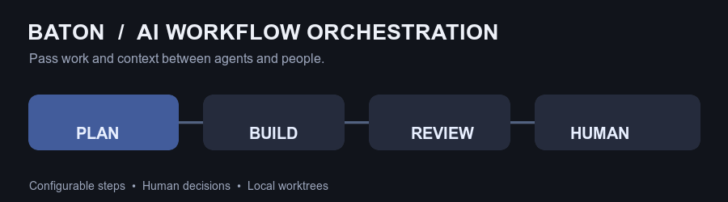

# Baton

Baton orchestrates AI agents through configurable pipelines. Like a relay baton, it passes work and context from one step to the next, coordinating agents and human decisions along the way. It combines a Rust API and CLI with a SvelteKit interface for configuring agents, managing tasks and reviewing runs. Baton controls the workflow; agent runtimes execute individual steps.



_An example workflow; pipeline steps and transitions are configurable._

## Install the CLI

On macOS or glibc-based Linux (x86-64 or ARM64), install the latest GitHub Release:

```sh
curl -fsSL https://raw.githubusercontent.com/klab365/baton/main/install.sh | sh
```

The script installs `baton` to `~/.local/bin`; make sure that directory is on your `PATH`. Set `BATON_INSTALL_DIR` to change the destination or `BATON_VERSION` to select a release, for example:

```sh
curl -fsSL https://raw.githubusercontent.com/klab365/baton/main/install.sh | BATON_VERSION=0.1.0 sh
```

You can instead download an archive from [GitHub Releases](https://github.com/klab365/baton/releases) and manage the binary with your preferred tooling, including mise. Linux builds target glibc, not musl. The release binary includes the API and web UI; Node and Bun are not required at runtime.

## Get started

In a Git project, start the installed API:

```sh
cd /path/to/project
baton
```

On first launch Baton creates `.baton/` and initializes the project configuration automatically. Open <http://127.0.0.1:5173> for the embedded UI. `BATON_HOST` may only resolve to loopback addresses; external binding is not supported. Baton has no authentication and must not be exposed through a reverse proxy. `BATON_PORT` changes the starting port. If it is occupied, Baton uses the next available port and prints the address. Configure credentials and agents, create a pipeline, then create and start a task. Follow the [Software Factory getting started guide](docs/getting-started.md) for a complete example. The `fake` runtime is available for offline testing. Agent execution requires Git; real model execution also requires a compatible provider credential.

A worktree is **not a sandbox**: agents may run commands with the permissions of the Baton process. Use a container, VM or dedicated OS user for stronger isolation. Task prompts and run data are local and can be sensitive.

Pipeline shell steps run their configured `sh -c` command in the task worktree, with the Baton process's permissions (not in a sandbox). They stop on cancellation and time out after 300 seconds by default; set `timeoutSeconds` per shell step (1–86400 seconds) to change the limit. Exit code 0 produces `completed`; all other exit statuses and timeouts produce `failed`. Configure transitions for those outcomes to route results; without a matching route, failures stop the run. The exit status and bounded stdout/stderr are passed to later steps. Shell steps do not create commits and are not supported in external `baton work` sessions.

Agents can be configured with an explicit allowed tool list in the Agents UI. An omitted list preserves the default tools; an empty list disables all tools. Steps with transitions require `report_outcome`. Disabling `write` and `edit` does not prevent changes if `shell` is enabled: shell commands can modify files and access resources outside the worktree.

## Set up with a coding agent

Copy this prompt into your coding agent from the Git repository where you want to use Baton:

```text
Help me set up Baton for this repository. First read the current agent setup guide:
https://github.com/klab365/baton/blob/main/docs/getting-started-for-agents.md
Follow it, inspect my environment and existing configuration, and ask me before
making changes or taking actions that need my approval. Do not overwrite existing
configuration or ask me to paste secrets into this conversation.
```

See the [agent setup guide](docs/getting-started-for-agents.md) for what the agent will do and for links to the full documentation.

## Development

```sh
mise install
(cd packages/baton-web && bun install --frozen-lockfile)
mise run dev
```

This starts the API and Vite development UI using `examples/demo`. The API is on port 5173 and Vite on port 5174, proxying `/api` to the backend. The development proxy validates local Host and browser Origin headers before forwarding API requests, including mutations. It is intended only for local development and must not be exposed remotely. To build a standalone binary from source, run `(cd packages/baton-web && bun run build)` followed by `BATON_WEB_DIR="$PWD/packages/baton-web/build" cargo build --release -p baton-cli`. Without `BATON_WEB_DIR`, Rust builds show a placeholder instead of the embedded UI. To run checks:

```sh
mise run check-format
mise run lint
mise run check
mise run test
mise run test-embedded-web
mise run build
```

## Documentation

- [User guide](docs/user-guide.md) — features, workflows, CLI and troubleshooting
- [Getting started: build a Software Factory](docs/getting-started.md), [setup for coding agents](docs/getting-started-for-agents.md), and the [example project](examples/demo/)
- [Architecture and request lifecycle](docs/architecture.md)
- [Project configuration](docs/project-configuration.md)
- [Pipelines](docs/pipelines.md) and [workflow transitions](docs/workflow-transitions.md)
- [Tasks](docs/tasks.md) and [runtime orchestration](docs/orchestration.md)
- [Work in an existing Pi, Claude Code or Codex session](docs/session-work.md)
- [Skills](docs/skills.md) and [provider credentials](docs/local-provider-storage.md)
- [Release process](docs/releases.md)

Baton currently runs agents locally; remote execution targets are not implemented.

## Browser tests

Install dependencies with `mise install`, then install Chromium with `cd packages/baton-web && bunx playwright install chromium`. From the repository root run `mise run test-browser`. The tests use mocked API responses and do not require a running backend. CI installs Chromium and its system dependencies before running them.
